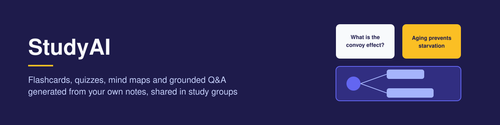
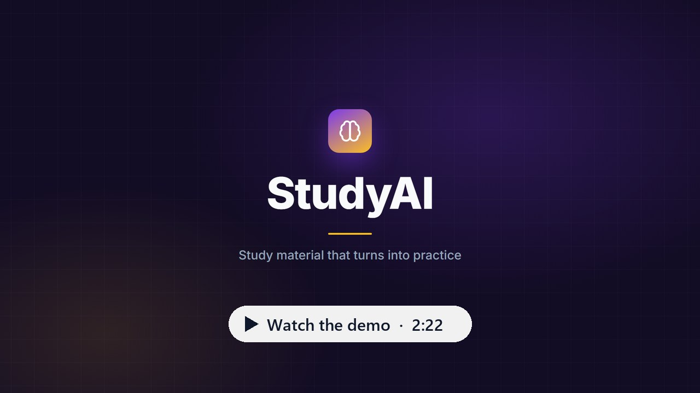
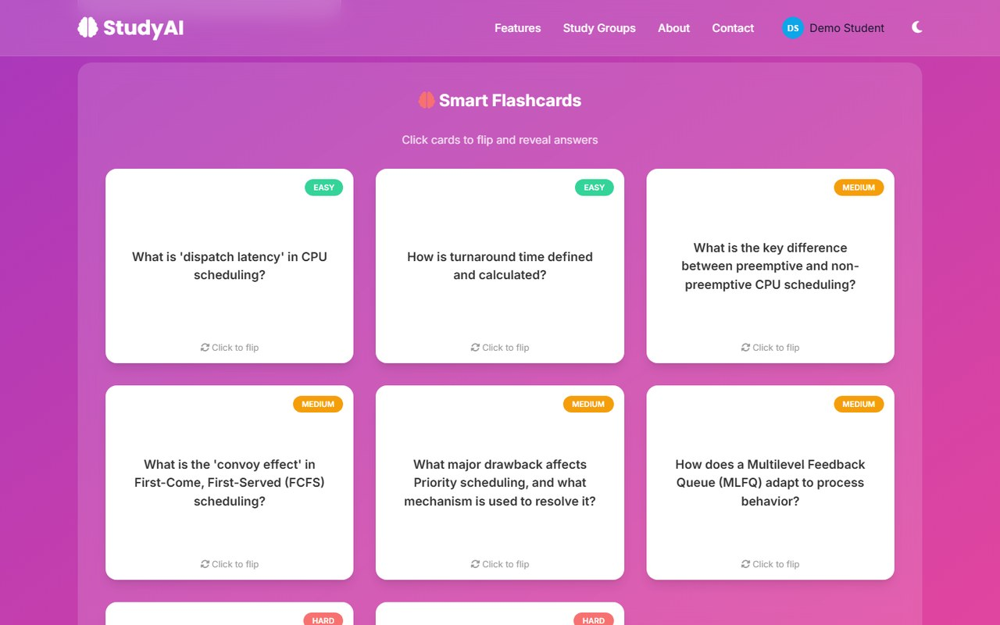
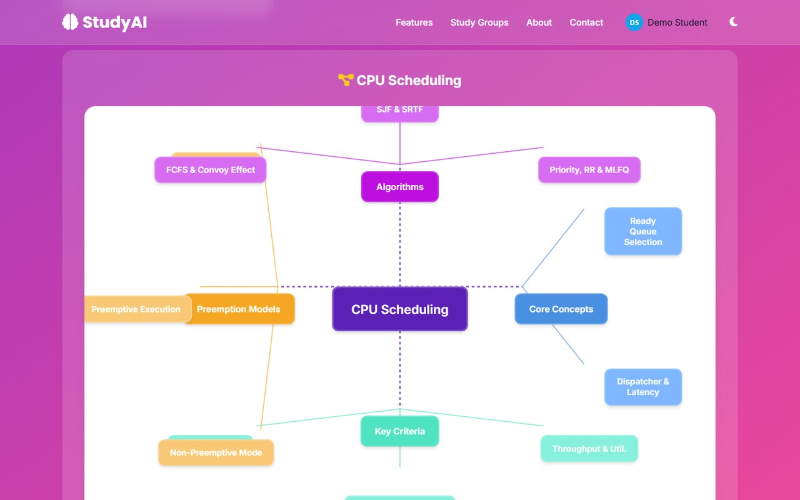
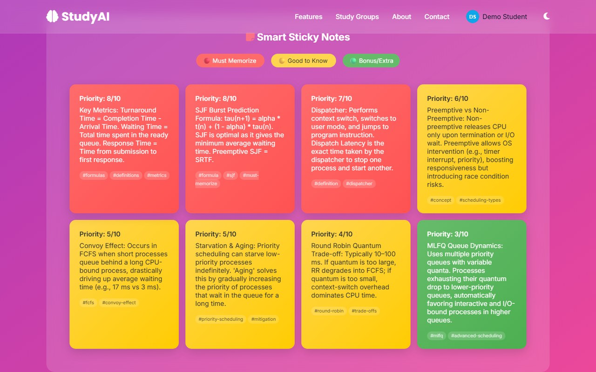
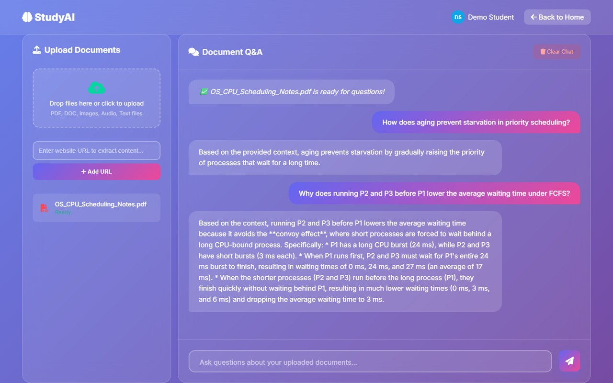
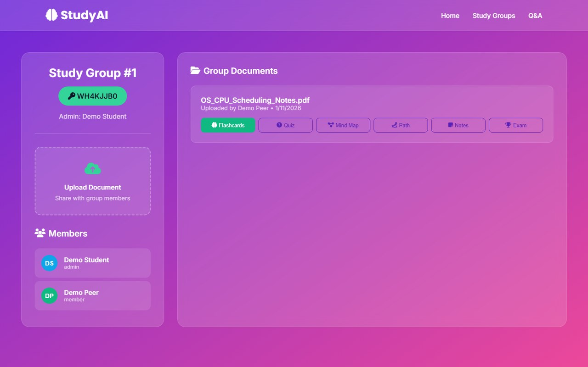
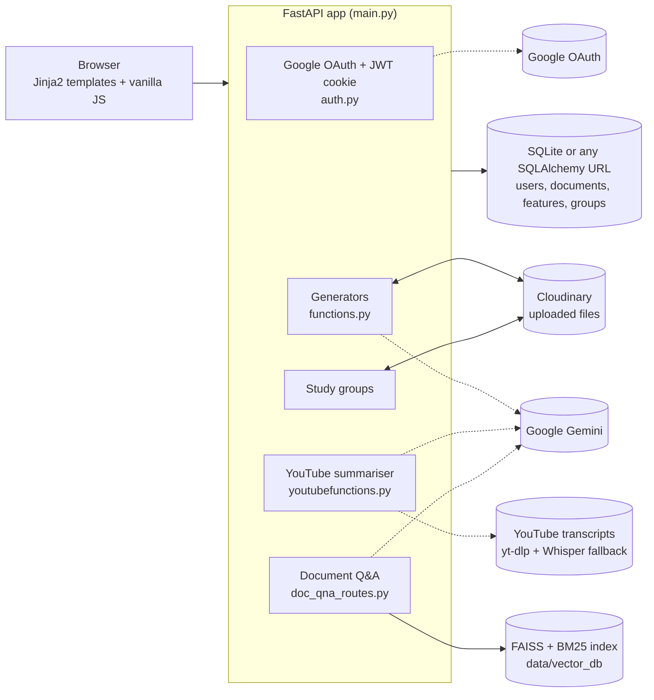

<p align="center">
  
</p>

<p align="center">
  A FastAPI study platform that turns uploaded notes into flashcards, quizzes, mind maps, learning paths, revision notes and likely exam questions, answers questions about a document through hybrid retrieval, and lets study groups share both.
</p>

<p align="center">
  
  
  
  
</p>

<p align="center">
  <a href="https://drive.google.com/file/d/1bq5EJROvsifbRsGJLoaQP4rgihgUSnEp/view?usp=sharing">
    
  </a>
</p>
<p align="center"><em>Demo video (2:22): flashcards, quizzes, mind maps, revision notes, learning paths, exam questions, document Q&amp;A and study groups.</em></p>

Built by a three-person team for the APIHub Hackathon 2025, where it placed third.

---

## Contents

- [Problem](#problem)
- [What it does](#what-it-does)
- [Screenshots](#screenshots)
- [Architecture](#architecture)
- [Engineering decisions](#engineering-decisions)
- [Feature status](#feature-status)
- [Local setup](#local-setup)
- [Limitations](#limitations)
- [Team](#team)

## Problem

Students revise from their own material: lecture slides, PDFs, notes, recorded lectures. Turning that into active-recall practice (flashcards, self-tests, a revision plan) is slow, so most revision ends up as re-reading. General chatbots can generate questions, but they do not stay grounded in the student's own document, do not keep what they generated, and do not support studying with classmates.

## What it does

- **Six generators from one upload.** For an uploaded PDF, DOCX or text file, Gemini produces flashcards with difficulty levels, multiple-choice questions, a hierarchical mind map, a step-by-step learning path with prerequisites and time estimates, colour-coded revision notes by priority, and likely exam questions with a probability score. Each prompt asks for structured JSON that the frontend renders directly.
- **Everything is saved.** Uploaded files go to Cloudinary. Each document and each generated feature is a row in SQL (SQLAlchemy, 7 tables), so a user can reopen past results instead of regenerating them.
- **Document Q&A.** A separate chat page indexes uploaded files, web pages or images into FAISS (dense, `all-MiniLM-L6-v2`) and BM25 (sparse), retrieves passages for each question, and has Gemini answer only from that context. It declines questions the document does not cover.
- **Study groups.** A user creates a group and shares its 8-character key. Members upload documents to the group, generate any feature on any group document, and see what others have generated.
- **YouTube summaries.** The transcript is fetched with `youtube-transcript-api` and summarised into a structured study guide. If a video has no transcript, the audio is downloaded with `yt-dlp` and transcribed with Whisper.
- **Google sign-in** through OAuth 2.0, with a signed JWT session cookie.

## Screenshots

All screenshots were captured from a local run on a two-page set of operating-systems notes (CPU scheduling). Every result shown was generated live by the app from that file.

| Flashcards | Mind map |
|---|---|
|  |  |
| **Revision notes by priority** | **Document Q&A** |
|  |  |

<p align="center">
  
</p>
<p align="center"><em>Study group: a document uploaded by one member, flashcards generated by another, and the group key for inviting others.</em></p>

## Architecture



**Generating a feature:** the browser uploads the file to `/api/upload-document`, which stores it in Cloudinary and records a `UserDocument`. It then calls `/api/generate-<feature>-auth` with the document id. The server downloads the file, extracts text with PyPDF2 or python-docx, prompts Gemini for JSON, saves the result as a `GeneratedFeature`, and returns it.

**Answering a question:** files uploaded on the Q&A page are extracted (pdfplumber for PDFs, EasyOCR for images, Playwright for JavaScript-rendered pages) in a background thread and split into 600-character chunks with 100 characters of overlap. Each chunk is embedded into FAISS and added to a BM25 index. For a question, the app runs dense search with the question itself and with a one-line LLM rewrite of it, adds BM25 matches, removes duplicates, and sends the top passages to Gemini with an instruction to answer only from them.

## Engineering decisions

- **Hybrid retrieval.** Dense embeddings catch paraphrases; BM25 catches exact terms such as algorithm names, formulas and acronyms (SJF, MLFQ) that small embedding models blur. Results from both are merged before generation.
- **Query rewriting without losing the question.** The LLM rewrite adds related keywords, but the user's own question is always searched first. An earlier version searched only with the rewrite, which came back as several paragraphs and pulled retrieval off-topic.
- **Structured JSON from the model.** Each generator asks Gemini for a fixed JSON shape, and the frontend renders that shape directly (flip cards, a node graph, priority-coloured notes) instead of free text.
- **Persist, do not regenerate.** Saving each generated feature against its document makes results reusable, lets group members see each other's work, and avoids paying for the same generation twice.
- **Signed download fallback.** Cloudinary blocks public delivery of PDFs on new accounts. When the public URL is refused, the server fetches the file through Cloudinary's signed download API instead.
- **Rule-based fallbacks.** If Gemini is unavailable, the generators return simpler rule-based output built from the document's text, so the interface still works.

## Feature status

What was exercised end to end in a local run (November 2026) with live Gemini and Cloudinary credentials:

| Area | Status |
|---|---|
| Upload to Cloudinary and all six generators | Tested in the browser and through the API |
| Document Q&A on a PDF (indexing, retrieval, grounded answers, refusal when off-topic) | Tested in the browser and through the API |
| Study groups: create, join by key, shared upload and generation, member roles | Tested with two accounts |
| YouTube summary from a transcript | Tested |
| Google OAuth sign-in | Redirect to Google tested; the screenshots use a local test account with a session signed by the app's own `create_access_token`, not a full Google sign-in |
| Whisper fallback for videos without transcripts | Not tested (downloads the 1.5 GB `medium` model on first use) |
| Audio files on the Q&A page | Disabled in code (`whisper_model = None`) |

## Local setup

### Prerequisites

- Python 3.12
- A Google Cloud OAuth client (web application) with the redirect URI `http://localhost:8000/auth/callback`
- A Cloudinary account
- A Google Gemini API key

### Install

```bash
git clone https://github.com/Siddharthpandey20/Study_AI_Complete_Project.git
cd Study_AI_Complete_Project

python -m venv venv
# Windows: venv\Scripts\activate
# Linux/macOS: source venv/bin/activate

pip install -r requirements-lock.txt   # exact versions verified on Python 3.12
pip install ./whisper-main             # bundled copy of OpenAI Whisper
python -m playwright install chromium  # only needed for JavaScript-rendered URLs on the Q&A page
```

`requirements.txt` lists the same top-level packages with pinned versions. The lock file also pins every transitive dependency, which is the reliable route; unpinned LangChain 1.x removes imports this code uses.

### Configure

Copy `.env.example` to `.env` and fill in:

| Variable | Purpose |
|---|---|
| `GOOGLE_CLIENT_ID`, `GOOGLE_CLIENT_SECRET` | Google sign-in |
| `CLOUDINARY_CLOUD_NAME`, `CLOUDINARY_API_KEY`, `CLOUDINARY_API_SECRET` | File storage |
| `SECRET_KEY` | Signs session tokens |
| `GEMINI_API_KEY` | All generation and Q&A |
| `GEMINI_MODEL` | Optional; defaults to `gemini-flash-latest` |
| `DATABASE_URL` | Optional; defaults to `sqlite:///./study_ai.db` |

All of the first four rows are required at start-up.

### Run

```bash
python run.py
```

Open `http://localhost:8000`. The first start downloads the sentence-transformers and EasyOCR models, which takes a few minutes. API documentation is at `/docs`.

### Demo walkthrough

1. Sign in with Google.
2. On the home page, choose a PDF and click **Smart Revision Mode**, then **Mind Map Generator**, **Smart Sticky Notes** and **Exam Booster Mode**.
3. Open **Document Q&A**, upload the same PDF, wait for "ready for questions", and ask about a detail from the second page.
4. Open **Study Groups**, create a group, upload a document and generate flashcards inside the group.

### Troubleshooting

- **`GOOGLE_CLIENT_ID environment variable is required` at start-up:** `.env` is missing or not in the project root.
- **`redirect_uri_mismatch` from Google:** add `http://localhost:8000/auth/callback` to the OAuth client's authorised redirect URIs.
- **Generated content looks generic:** check the server log for `HTTP error accessing`. The app could not download the stored file, and the generators fell back to placeholder text (see [limitations](#limitations)).
- **Document Q&A says no documents are available after a restart:** the saved index is only reloaded after the next upload, so upload the file again.

## Limitations

- **Document Q&A is not per-user.** Its routes do not require sign-in, and all uploads share one index that is cleared every hour. It suits a single-user demo, not a multi-user deployment.
- **Placeholder content on download failure.** If a stored file cannot be fetched, the generators quietly fall back to generic study text built from the file name instead of returning an error.
- **Each generator click re-uploads the file** to Cloudinary before generating.
- **No automated tests** beyond the bundled Whisper package's own tests.
- `routes_for_DOC_QNA.py` is an earlier standalone version of Document Q&A (including a LangGraph tool-calling agent). It is not imported by the app and depends on modules that are not in the repository.

## Team

- [Siddharthpandey20](https://github.com/Siddharthpandey20)
- [Utkarsh240102](https://github.com/Utkarsh240102)
- [akhilll0305](https://github.com/akhilll0305)

Built with [FastAPI](https://fastapi.tiangolo.com/), [LangChain](https://www.langchain.com/), [FAISS](https://github.com/facebookresearch/faiss), [rank-bm25](https://github.com/dorianbrown/rank_bm25), [Google Gemini](https://ai.google.dev/), [Cloudinary](https://cloudinary.com/), [EasyOCR](https://github.com/JaidedAI/EasyOCR) and [OpenAI Whisper](https://github.com/openai/whisper).
